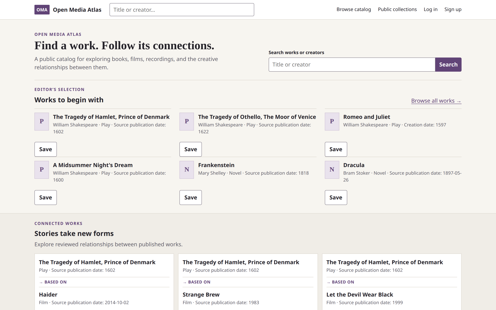
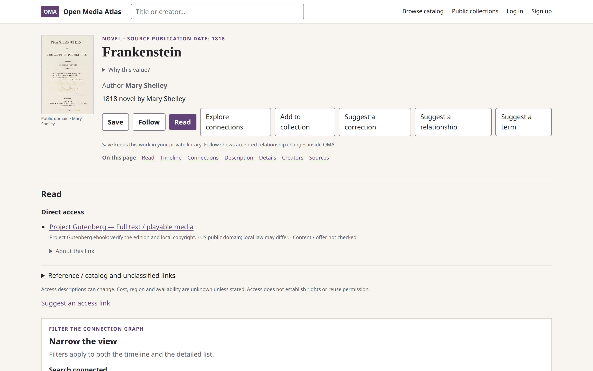
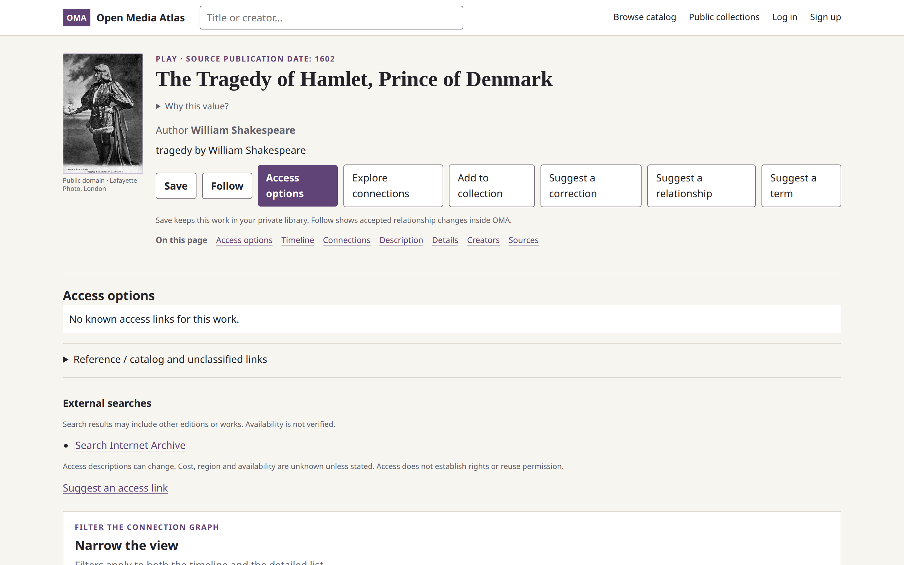
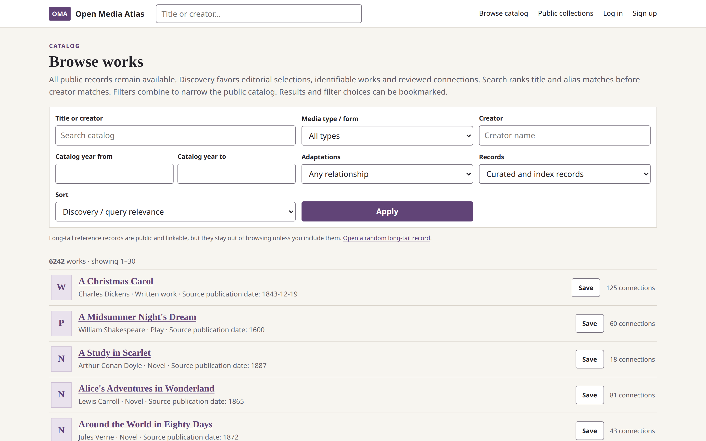
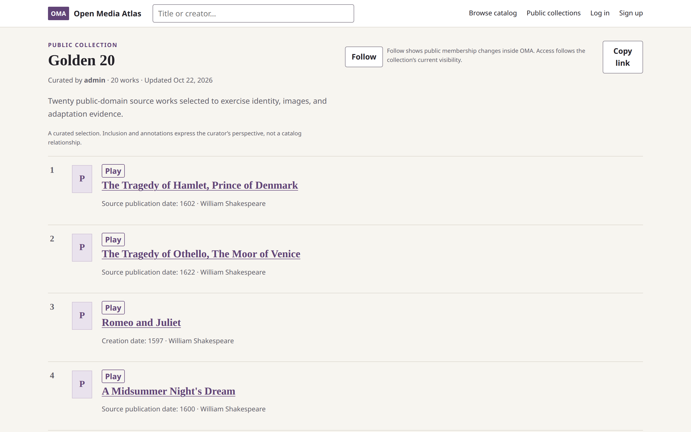
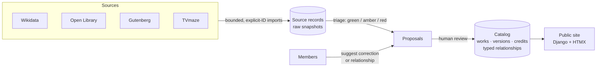

# Open Media Atlas

**Find a work. Follow its connections.** Open Media Atlas (OMA) is an open, cross-media catalog of creative works (books, plays, films, TV and games) and the relationships between them: what adapts what, which titles are really the same work, and the source behind every link.

> **Status: in active development, and looking for someone to take it further.** The core catalog, the import pipeline and the review workflow all work locally against a real ~14k-work dataset. It isn't deployed publicly yet. If you want to pick it up, fork it or open an issue. The design docs are written so that someone new can take it over.



## Why

Ask "what has *Frankenstein* been adapted into?" and the answer is spread across Wikipedia lists, IMDb trivia, library catalogs and fan wikis. None of them separate a real adaptation from something that was only loosely inspired by the original, and none show where the claim came from. OMA treats relationships between works as the main data. Each link is typed, has a direction and a date, and points back to the source statement behind it.

## What it does today

| | |
|---|---|
|  |  |
| **Work pages** list access links (e.g. Project Gutenberg), a timeline of adaptations, typed connections, credits and the sources for each field ("Why this value?"). | **Connection timelines** show how a work moved across media, e.g. *Hamlet* → *Haider* (2014) and *Strange Brew* (1983). |
|  |  |
| **Discover** lets you browse and filter by media type, with HTMX partial updates. | **Public collections** are annotated, ordered lists of works that members can curate. |

- **Catalog:** about 13.9k works, 5.6k work-to-work relationships, 19.6k credits and 14k source records in the local snapshot. The data comes from Wikidata, Open Library, Project Gutenberg and TVmaze.
- **Provenance:** imported source snapshots are kept separate from accepted catalog values, and a manual editorial override survives reimports.
- **Community review:** verified members can propose corrections and new relationships. Nothing goes public until a reviewer approves it.
- **Accounts:** signup, email verification, password reset, a private library and lists, with abuse limits stored in the database.

## How it works



- **Stack:** Django monolith, server-rendered templates with HTMX, PostgreSQL in production (SQLite locally), WhiteNoise for static files, and a Render blueprint for staging.
- **Rules the code enforces:** stable internal IDs, external identifiers stored separately, public queries filter on visibility and review status, and no network imports run during a request, build or migration.

## Where it's going

The [strategy doc](docs/planning/oma-strategy-2026-11.md) sets out eight questions OMA should answer better than anywhere else. Next up:

1. **Make the graph mean what it says.** Tighten the relationship vocabulary ("adaptation of" vs. "inspired by"), and fix direction and duplicate-identity problems.
2. **Creator pages and series grouping.** Credits already exist; there are no pages for people or series yet.
3. **A read API** with machine-readable provenance and uncertainty, so other tools can build on the catalog.
4. **Agent contributions** through the same proposal-and-review path humans use ([design](docs/planning/agent-contribution-and-api-2026-11.md)).

Decisions and their reasoning are in the [decision register](docs/decision-register.md).

## Run it locally

Requires Python 3.12+.

```bash
python -m venv .venv && source .venv/bin/activate
pip install -r requirements.txt
cp .env.example .env
export DJANGO_DEBUG=true
python manage.py migrate
python manage.py load_demo_catalog          # small fictional demo dataset
python manage.py runserver 127.0.0.1:8000
```

To load real data, use the bounded Open Library import (`python manage.py import_openlibrary --file data/openlibrary-curated.txt --limit 24`). The full ingestion campaign is documented in [docs/ingest-campaign-run1.md](docs/ingest-campaign-run1.md).

Tests: `DJANGO_DEBUG=true python manage.py test`

**More detail:** deployment (Render), email configuration, the contribution-review setup and import operations are in [docs/DEVELOPMENT.md](docs/DEVELOPMENT.md).

## License

[MIT](LICENSE)
