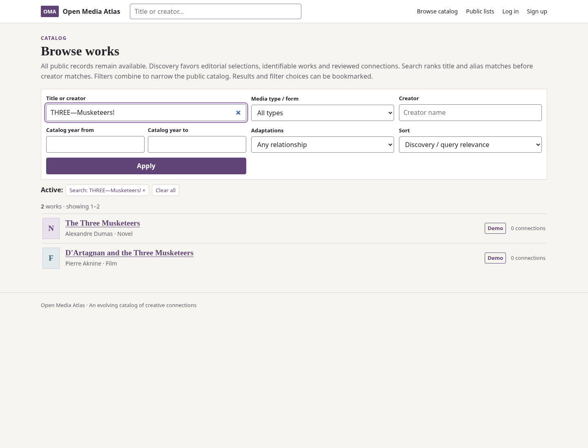
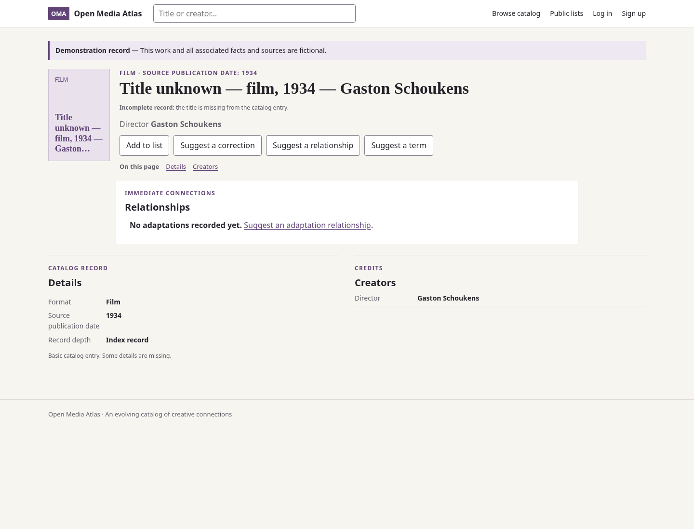

# Trustworthy catalog labels and discovery (chunk 1)

This change uses Django, the existing WorkType vocabulary, and cached SourceRecord
JSON. It adds two Work fields (`date_kind`, `date_evidence`), without rewriting any
existing dates. Migration 0013 defaults legacy dates to meaning unverified. Supplier
classifications, aliases, statements, qualifiers, references, identifiers and edition
records remain available separately from public presentation.

## Date diagnosis

Read-only public-page and Open Library API checks during implementation confirmed:

| OMA work ID | Work | Open Library work | Supplied `first_publish_date` / displayed “Original date” |
| --- | --- | --- | --- |
| 13 | To Kill a Mockingbird | OL3140822W | 1969 |
| 3 | Pride and Prejudice | OL66554W | 1853 |
| 4 | Frankenstein; or, The Modern Prometheus | OL450063W | 2006 |

Sources: [Mockingbird](https://openlibrary.org/works/OL3140822W.json),
[Pride and Prejudice](https://openlibrary.org/works/OL66554W.json),
[Frankenstein](https://openlibrary.org/works/OL450063W.json).

The targeted importer directly copies that supplier field into
`first_publication_date_text` / `first_publication_year`; it does **not** select dates
from editions. The bulk importer copies the same work field and keeps edition
`publish_date` values separately in Release. Thus the reported dates originate in
Open Library work metadata, and the template incorrectly promoted that metadata to
an original-date claim. These checks do not prove which edition, source error, or
cataloging choice caused Open Library to assign each value. Do not silently replace
them with familiar years or use the earliest sampled edition as an original date.

New Open Library dates are explicitly source publication assertions. Wikidata no
longer takes an arbitrary first P577 claim or treats P571 inception as publication:
non-deprecated claims retain their meanings and year/month/day precision. A unique
preferred date can resolve selection; otherwise conflicting dates leave the work date
unset and stay in the raw source snapshot. Neither supplier path claims “First
published/released.” Those labels require explicit accepted evidence with a matching
date and source URL, supplied through reviewed corrections or the scoped manifest.
Date corrections preserve the previous value in evidence; source snapshots are not
rewritten. Title-only Wikidata enrichment no longer erases last-imported date state.

Existing wrong dates and year filtering remain inaccurate until individually corrected.
After code deployment they will be marked “Date (meaning unverified),” not original.
Reviewed date edits are protected from subsequent supplier updates, including edits
whose accepted value happens to equal the last imported value.

The live Three Musketeers search also confirmed Dumas's novel at OMA work 5048,
with a generic Literary work label. Wikidata Q140527 supplies P31 = literary work
and P7937 = novel, with no English alias in the inspected entity. Public presentation
now uses that explicit form assertion, and query relevance favors its tighter title
match over longer related titles, without inventing an alias or hiding adaptations.

## Safe correction procedure (not executed against production)

Use the existing production environment's usual shell **after** migration 0013.
No staging infrastructure or network import is needed. First inspect only the three
observed IDs; this command is read-only and reports supplier state, current values,
reviewed date edits, and expected timestamps:

```bash
python manage.py correct_catalog_dates --inspect 13 3 4 > date-inspection.jsonl
```

Review exact record identity, source snapshots and original-edition/release evidence.
Prepare a JSON list of at most 20 explicit entries. Each entry must contain:

```json
{
  "work_id": 13,
  "expected_date_text": "1969",
  "expected_year": 1969,
  "expected_updated_at": "COPY THE EXACT TIMESTAMP FROM INSPECTION",
  "date_text": "COPY THE DATE SUPPORTED BY THE REVIEWED SOURCE",
  "year": null,
  "date_kind": "first_publication",
  "source_url": "https://SOURCE-THAT-ESTABLISHES-THE-ORIGINAL-DATE",
  "basis": "Explain what establishes original publication, record identity and precision."
}
```

Set `year` to the supported year, or null when evidence does not establish one. Keep
year-only dates as years; do not manufacture month/day values. Use `publication`,
`release`, `edition`, `inception`, or `unknown` when original publication/release is
not established. The template above deliberately is not an executable production
correction. Source verification is still required for all three records.

```bash
python manage.py correct_catalog_dates --manifest reviewed-dates.json --dry-run > date-dry-run.jsonl
# Review every before/after, supplier mapping and skip/conflict result first.
# Only an authorized operator should then run:
python manage.py correct_catalog_dates --manifest reviewed-dates.json --apply
```

Without `--apply` the command never writes, including ImportRun/Source records. It
locks each work for application, compares date/year/update timestamp, skips editorial
entries and reviewed date corrections, and preserves conflicts. Reusing the exact
manifest after successful application reports `unchanged`. No identifiers, slugs,
URLs, relationships, releases, or supplier snapshots are changed. Existing reviewed
records should use the existing sourced proposal/admin review workflow instead.

An actual isolated-fixture dry run reported `would_update`, with before `2006` / 2006
and after `1818` / 1818, preserving year-only precision; the fixture was unchanged.
Automated tests also apply that synthetic correction, rerun it, and check conflict
and reviewed-edit protection. No production correction has been applied or dry-run
against a production database in this session.

## Public taxonomy and record language

Books includes books and confidently classified novels. Generic literary/written
records stay under Written works (type unspecified); creative/unknown records stay
under Unclassified works and All types. A cached, non-deprecated direct Wikidata
P31 classification or P7937 form assertion can make a generic label specific; conflicting specific assertions
remain generic. No title-based inference or new taxonomy tables are introduced.
Legacy specific type URLs remain supported. Result and work-page labels use the same
resolver as filter membership; raw WorkType and supplier claims are preserved.

Publication currently depends on visibility/reviewer actions, not an enforced identity
standard. The public wording now describes a basic catalog entry without that quality
claim. Missing titles have a marked type/year/creator fallback, using record ID when
creator is missing; canonical titles and stable URLs are unchanged. No queue is claimed.
Unknown permission boilerplate is removed. Scope notes, source links and substantive
attributed `evidence.authorization_statement` text remain accessible; accepted
relationships do not establish legal permission.

## Ordering and modest search implementation

No query: editorial homepage selections first, then known title, creator information,
editorial depth and presence of a reviewed public connection; raw connection count is
not a ranking factor. Sparse records are still paginated and reachable. Query: normalized
canonical exact title, supplied exact alias, title word/prefix sequence, alias sequence,
creator sequence. Partial matches with less unmatched title/alias text rank ahead of
longer related titles; discovery signals only break relevance ties. No translated titles or
semantic equivalents are manufactured. Explicit alphabetical/newest/oldest sorting
always wins. Year sorts/filter labels refer to catalog dates, which may be unverified.
Homepage/navigation/browse all describe title-or-creator search.

The ORM handles visibility, relational/year filters, sorting and pagination. Query
matching and public-type membership inspect prefetched cached supplier JSON in Python
because aliases are currently stored there, not in an alias table. This avoids database-
specific JSON search and a new service for the current modest catalog. It is linear in
the filtered catalog size; revisit a maintained alias/search projection if catalog
size makes this path slow. Unqueried unfiltered browse only loads the page's snapshots.
Selected filters/sort/query/page remain in GET URLs and HTMX push-state.

## Validation and local preview

- Django suite: 83 tests passing on SQLite, including 12 focused regressions for dates,
  type grouping/conflicts, missing titles, aliases/relevance, pagination, explicit sort,
  sparse records, authorization language and safe corrections.
- `python manage.py makemigrations --check --dry-run`: no changes detected.
- `git diff --check`: clean.
- Chromium desktop and 390px mobile: homepage → browse → Books filter → punctuation-
  normalized Three Musketeers search → novel detail → missing-title detail. Novel and
  adaptation both remained available, HTMX updated the URL, no mobile horizontal
  overflow, and the completed journey had no page JavaScript errors. Fixed an existing
  empty-fragment selector exception found on work pages during this check.
- Screenshots captured locally for homepage, browse, search, work, missing title and
  mobile search; all local real-title test records were explicitly marked Demo.

For a fresh local checkout (SQLite fallback; do not set a production DATABASE_URL):

```bash
python -m venv .venv
. .venv/bin/activate
pip install -r requirements.txt
export DJANGO_DEBUG=true
python manage.py migrate
python manage.py load_demo_catalog
python manage.py runserver 127.0.0.1:8000
```

Open http://127.0.0.1:8000/, then Browse catalog; search “Glass”, select Books, and open
a work. The standard synthetic catalog is enough to inspect labels/filters. Tests use
isolated fixtures for the Dumas/alias cases. There is no hosted preview or staging site.
Deploy only through the existing reviewed PR merge/deploy workflow; no merge/deploy
or bulk ingestion is part of this change. No new product decision is required; the
remaining catalog action is source review and narrowly scoped date correction.

## Review screenshots

Captured from the changed code in the isolated Demo catalog, not production.




